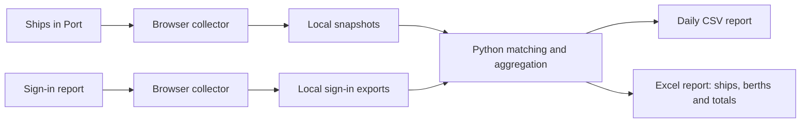

# Seafarer Visits Reporting Pipeline

A Windows-based data pipeline that brings together ships-in-port snapshots and seafarer sign-in records to produce daily, month-to-date and quarter-to-date reports. Built as a reporting project for the Mission to Seafarers.

> This repository is a portfolio copy. It contains source code and documentation only; it does not include real sign-in records, ship snapshots, login details, reports or browser sessions. The live operational setup is maintained separately.

## What it does

1. Uses Playwright to collect a timestamped snapshot of the Ships in Port page.
2. Exports the latest seven days of sign-in records and keeps each export separately.
3. Filters the selected berth codes and matches records by ship and date.
4. Counts a named person once per ship per reporting period and estimates crew using 22 people per ship.
5. Builds ship, berth and total summaries for daily, month-to-date and quarter-to-date reporting.
6. Can run manually or on a Windows schedule at midnight, 9 am, noon and 6 pm local time.



## Example of the output

The figures below are **invented** to explain the calculation. They are not operational data.

| Ship | Estimated crew | Different people who visited | Percentage |
| --- | ---: | ---: | ---: |
| Example vessel A | 22 | 3 | 13.6% |
| Example vessel B | 22 | 0 | 0.0% |

The percentage is the distinct count of people matched to that ship divided by estimated crew. The report leaves the visitor count blank when sign-in coverage is unknown; a zero is only shown when sign-in records exist for that period and no match was found. Both zeros and counts should be reviewed against coverage and matching limitations.

## Technology

- Python 3.13, openpyxl, tzdata and a documented Jupyter notebook
- Node.js 22 and Playwright for browser automation
- Windows Task Scheduler and Microsoft Edge
- CSV and Excel reports

The **Excel workbook generator currently relies on Codex's bundled `@oai/artifact-tool`**, which is not included in this repository and is not available through the public npm registry. The collectors and daily CSV use the project environment independently of Codex. To reproduce the Excel workbook, the compatible bundled spreadsheet runtime must also be present at the path referenced in `automation/build_report.mjs`; see `automation/collect_daily.cmd`. If it is unavailable, data collection and the daily CSV can still succeed but the full update reports a workbook error and keeps the previous workbook.

## Run with authorised data

The live collectors are designed for Windows and require access to the relevant source pages. Do not run them against accounts or data you are not authorised to use.

1. Install Python 3.13, Node.js 22, npm and Microsoft Edge. From PowerShell, in the repository folder, run:

   ```powershell
   powershell -ExecutionPolicy Bypass -File .\automation\setup.ps1
   ```

2. Set `PORTVIEW_URL` and `INFOODLE_URL` to the authorised HTTPS report pages. For a single PowerShell session:

   ```powershell
   $env:PORTVIEW_URL = '<authorised HTTPS ships-in-port page>'
   $env:INFOODLE_URL = '<authorised HTTPS sign-in report page>'
   ```

   For Task Scheduler, configure these as Windows user environment variables and sign out and back in before scheduling. They are deliberately not included in the repository.

3. Place authorised legacy sign-in CSV data at `data/sign_ins/MTSV Sign In Report.csv` and existing snapshots in `data/port_snapshots/`. The legacy file must have `Time`, `Name` and `Ship` columns; the timestamp format is `DD/MM/YYYY HH:MM:SS`. Do not commit these files. The notebook assumes `2026` for old snapshot names without a year; change `YEAR` for a different set.
4. For the PortView login, use `automation/setup_portview_login.cmd` to enter credentials in a Windows prompt. Windows encrypts them for the current Windows account in local app data, outside the repository. Code running as that same user may still be able to access them. Never put a password in a source file or commit it.
5. Run `automation/update_now.cmd`. Close generated reports in Excel first; an open file can block replacement. `automation/collection.log` records results. A previously installed Codex spreadsheet runtime is also needed for the Excel stage, as described above.
6. Optionally, run `automation/install_schedule.ps1` to create the separate `Seafarers Portfolio Collection` task. It uses the computer's local time; choose the Melbourne time zone if that is the intended schedule. The computer must be on, awake, connected and signed in.

The endpoint selectors reflect the websites inspected when this project was developed. Website changes, session expiry or additional authentication can require maintenance. The automatic collectors do not guarantee uninterrupted or comprehensive coverage.

## Data and reporting limitations

- A ship that arrives and leaves between snapshots may be missed. No snapshot is not evidence that no ships were present.
- Matching uses ship names, ignoring case and extra spaces; name differences can cause missed matches. Unmatched sign-ins are not included in totals.
- Distinct people are identified by name, which can merge different people sharing a name or split one person whose name is entered differently.
- A ship seen at more than one berth can appear under each berth; berth subtotals should not be added to derive the overall total.
- The 22-person crew figure is an estimate, not actual crew numbers. Calendar quarters are used. Period reports are based on available snapshots, not complete port history.
- A seven-day rolling export cannot recover older sign-ins absent from earlier saved exports; a missed PortView snapshot cannot be reconstructed automatically.
- The workbook shows incomplete coverage and is regenerated on updates; save personal annotations elsewhere.

## Project structure

```text
automation/                    Collectors, report builder and setup scripts
daily_ship_pipeline.ipynb      Explained matching and daily reporting logic
docs/portfolio-case-study.md   Website-ready project description
```

Generated `data/`, `reports/`, `outputs/`, dependency directories, logs, Excel files and CSV files are ignored. Review files before publishing: ignore rules cannot remove files already committed, and they do not replace a privacy review.
